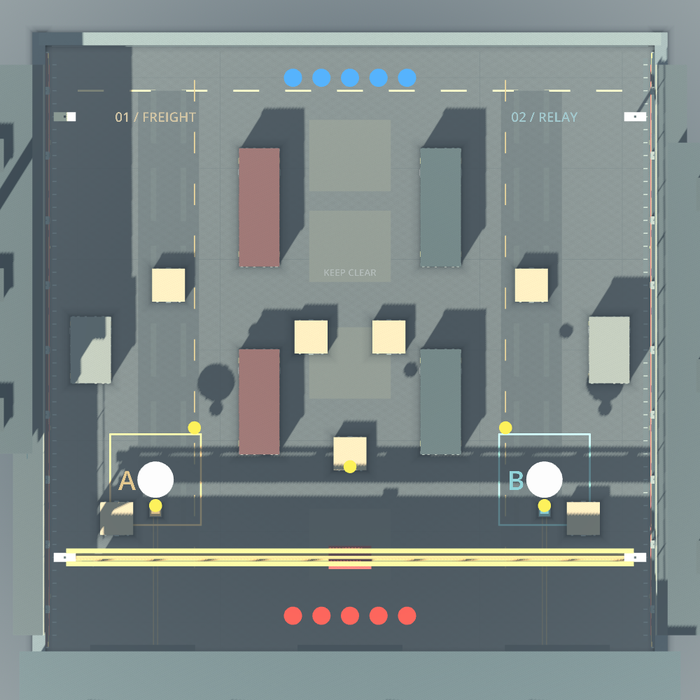
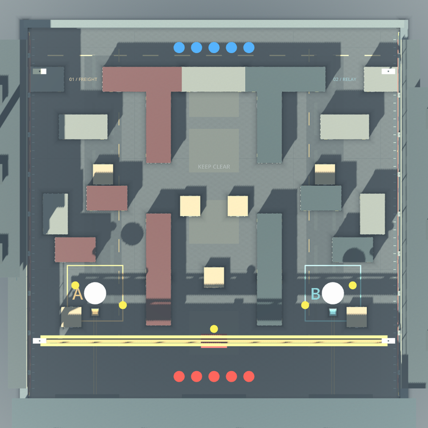

# Relay Yard layout on the v1 playability stack

Base: `830bf2ba` (head of draft PR #31, `codex/v1-executor-recovery-20261023`). Layout source: draft PR #26 (`claude/relay-yard-tactical-layout-v1`, commits `641b0c2a` and `fc423c4f`).

This record covers one blocker, how it was reproduced on the stack, what was changed, what was measured before and after with a harness other than the one the layout's author used, and what was not verified. It is evidence for a development candidate. It is not human play, device performance or native-platform acceptance.

## The blocker

On the playability stack, an attacker spawn and a defender spawn see each other across the whole yard. All 25 attacker-to-defender spawn pairs have an unobstructed head-height line, 41.5 to 42.4 m long (`tools/spawn_los.gd`: a ray cast through the real physics world with the mask and head height `SBActor.can_see` uses). The result is that rounds are decided in seconds and the plant, the objective the game is built around, almost never happens.

| Measured on `830bf2ba` | easy | normal | hard |
| --- | ---: | ---: | ---: |
| Matches / rounds | 8 / 76 | 16 / 166 | 8 / 84 |
| Median live round (p10 to p90) | 12.8 s (8.8 to 21.3) | 12.1 s (6.4 to 28.3) | 14.9 s (3.7 to 100) |
| Rounds with a plant | 1% | 15% (10 to 21%) | 0% (0 to 4%) |
| Rounds won by the attackers | 42% | 25% (19 to 32%) | 19% (12 to 29%) |
| Rounds that ended by detonation | 0 | 0 | 0 |

Half of the `normal` rounds are over within 12.1 s of going live. The human always starts as an attacker (`local_id = 1`, team 0).

The same defect was measured independently on an earlier stack in PR #26 (median round 12.0 s, first kill at 1.6 s, 94% of first kills inside a spawn zone, plants in 9% of rounds). The two measurements use different bases, harnesses and seeds and agree.

**Deterministic reproduction.** `game/tests/map_sightline_probe.gd --assert` fails on the old yard and passes on the new one:

```
ERROR: a defender hold position has a line to attacker spawn (-4.4, 0.05, -21.0)      (x5 spawns)
ERROR: attacker route to site 0 is 36.7 m, under 44 m
ERROR: attacker route to site 0 is 97% exposed
ERROR: attacker route to site 0 has an unbroken exposed stretch of 30 m
```

Raw output: [`data/sightline-probe-before.txt`](data/sightline-probe-before.txt), [`data/sightline-probe-after.txt`](data/sightline-probe-after.txt).

## What changed

| Area | Change | Origin |
| --- | --- | --- |
| Yard | 13 container solids (`LAYOUT_REVISION = 2`): a screen wall with two exits, exit blocks, lane dividers with two 2.5 m doors, site shields, spine extensions. Spawns, sites and the shell are unchanged. | PR #26, three-way merged onto the stack against the true merge base `c84eaf3c`. No conflicts. |
| Navigation | Grid 3 m to 2 m, so the 2.5 m doors are on the graph. `DEFENDER_ANCHORS` moved deeper. | PR #26 |
| Tests | `map_sightline_probe.gd --assert` (35 checks), `actor_test` and `world_test` assert the 25 original obstacles plus the 13 declared solids. | PR #26 |
| Handshake | The hello carries `layout`. A server refuses a client on another layout; a client refuses a server that sends none. A hello without the field is revision 1. Protocol stays 6. | New here. PR #26 listed this as open. |
| Layout guard | `handshake_layout_test.gd` fails if the collision solids change without a new `LAYOUT_REVISION`. | New here |
| Traversal test | `layout_route_test.gd` walks a real attacker through the physics along the bots' route and the native verifier's scripted route, to both sites, and plants. | New here |
| Harness | `bot_objective_metrics.gd` raises the tick rate with `--time-scale`. | Fix to PR #26's tool |
| Docs | `docs/design/RELAY_YARD_LAYOUT.md` records the design and what this integration changed. | PR #26, edited |

Not ported from PR #26: its rendered gallery capture, the blind-pair script and its images and critic reviews (they remain on its branch).

## After

Same 32 seeds and the same harness, on the new yard (`audit.sh`, see Reproduce):

| Measured on the new yard | easy | normal | hard |
| --- | ---: | ---: | ---: |
| Matches / rounds | 8 / 91 | 16 / 176 | 8 / 83 |
| Median live round (p10 to p90) | 25.5 s (11.4 to 30.8) | 22.7 s (15.8 to 30.1) | 13.0 s (9.3 to 22.4) |
| Rounds with a plant | 84% (75 to 90%) | 69% (62 to 75%) | 10% (5 to 18%) |
| Rounds won by the attackers | 42% (32 to 52%) | 64% (56 to 70%) | 75% (64 to 83%) |
| Rounds that ended by detonation | 0 | 0 | 0 |
| Rounds that ran out the clock | 0 | 1 | 0 |
| Invariant violations in all matches | 0 | 0 | 0 |

Once a site is reached the device is planted in a median of 3.1 s on every difficulty (the plant takes 3 s), so the carrier plants on arrival.

How to read this:

- **The loop now works on easy and normal.** Plants go from 1% to 84% and from 15% to 69%, and the median round roughly doubles. `normal` is the difficulty the player meets first.
- **Hard barely changes.** Plants go from 0% to 10% and the median round does not lengthen (14.9 s to 13.0 s), but the clock no longer runs out (12 of 84 rounds before, none after). Hard bots win the first fights at the exits. PR #26 saw the same (15%). That is bot tactics, not layout.
- **The attacker side is now favoured, not starved.** Attackers win 64% of `normal` rounds against 25% before. Both are far from an even game. This is bots with fair ordering (the stack's two-phase tick), not a balance verdict, and no human has played it. Tuning belongs to a separate change.
- **No round ends by detonation, before or after.** Defenders always defuse or are eliminated first. Not a defect found here, but a post-plant pressure question for tuning.

Raw per-match results: [`data/before.jsonl`](data/before.jsonl), [`data/after.jsonl`](data/after.jsonl). Seeded matches are deterministic: eight seeds re-run with a later harness revision were identical.

 

Top-down native render (software GL, relative only). Left: open pad. Right: revision 2.

## Regression coverage and negative controls

Each new check was shown to fail without the change it guards.

| Check | Result on the final tree | Fails when |
| --- | --- | --- |
| `map_sightline_probe.gd --assert` | 35 checks, 0 failures | Run on the old yard: 5 spawn lines plus route length, exposure and run failures (above). |
| `layout_route_test.gd` | 21 checks, 0 failures. Seven routes, 9.5 to 11.3 s of walking each, all plant. | The lane dividers stretched from 5 m to 14 m: 21 of 21 checks fail. |
| `handshake_layout_test.gd` | 26 checks, 0 failures | One solid moved by 0.5 m with the revision unchanged: the fingerprint check fails. |
| `test_handshake_hardening.sh` | 11 scenarios pass, including stale and unreadable layouts refused in about 0.55 s and a layout-less accept refused by the stock client | With the layout comparison disabled, the stale-layout peer is admitted. |
| `test_protocol_compat.sh` | 10 combinations pass, real server and client processes | See below. |

Mixed builds, real processes ([`data/protocol-compat-matrix.md`](data/protocol-compat-matrix.md)). The two new rows use `830bf2ba` as a real legacy build: protocol 6, no layout field.

| Client | Server | Result |
| --- | --- | --- |
| stack before layout 2 | this branch | refused after 0.1 s: "This server uses Relay Yard layout 2; this client sent layout 1." |
| this branch | stack before layout 2 | refused after 0.2 s: "This client uses Relay Yard layout 2; this server sent layout 1." |

The eight existing rows (0.3.0, published PR8, next protocol) are unchanged and pass.

## Cost

Fixed-camera benchmark (`scripts/profile_render.sh`, standard quality, three runs per view, two CPUs, Xvfb and Mesa llvmpipe). Counters are exact; frame times are relative only and are not device FPS.

| View | Draw calls | Primitives | Median frame |
| --- | --- | --- | --- |
| approach | 155 to 183 | 109,948 to 138,368 | 453 to 531 ms (+17%) |
| site | 48 to 54 | 72,196 to 99,952 | 397 to 468 ms (+18%) |
| overview | 166 to 214 | 75,674 to 104,714 | 338 to 439 ms (+30%) |
| operators | 138 to 156 | 75,024 to 103,140 | 367 to 437 ms (+19%) |

The yard goes from 1,472 to 2,544 box instances (nine static batches both times; the shadow share stays under the 60% budget at 55%). The extra geometry is the hardware detail on the 13 new containers, and `apply_detail_quality` only switches material features, so it applies in every tier. **This is a real cost to mobile.** It has not been measured on a device. Gating the small fittings by quality tier is the obvious follow-up.

## Findings that were not fixed here

1. **Carrier and escorts can deadlock at site A.** Seed 3, `normal`, round 2: the device carrier stops 4.9 m from the plant zone at (-11.4, 0, 13.2) between two attacker escorts holding at (-11.6, 13.8) and (-11.4, 12.6), which are the `SITE_HOLD_OFFSETS` positions for the open pad. Bots do not yield to each other and the unstick strafe and jump never clears it, so the round runs 100 s and the defenders win on time. It is the only such round in 350 (1 of 176 on `normal`). Reproduce with `tools/audit.sh out normal 3`: the second round reason is "Time expired" and `per_round[1].site_reached_t` is 12.7 with `plant_t` -1. A fix needs a way for a holding bot to give way to a blocked teammate, or hold offsets that stay out of the approach, and a measurement of both.
2. **Idle-bot detector hits are unexplained.** The detector flags a bot with no target that has not moved for 8 s while far from its destination. Twelve flagged positions were replayed with a lone actor using the bots' own navigation step; every one walked out and reached its destination with no stall, so they are not geometry traps. The old yard shows the same kind of hit, more often (129 unique on `normal` before, 63 after). Not claimed as a defect.
3. **Existing bot tests step physics at 1/15 s.** `bot_match_test`, `bot_lifecycle_test` and `bot_squad_observation` set `Engine.time_scale = 4` without raising the tick rate, and Godot scales the physics delta by the time scale. Their results are valid for what they assert, but the statistics that rest on them (bot symmetry, the 12-round matches) were not taken at the production step. `gunplay_rules_probe` already asserts the 60 Hz step. Left unchanged here.

## Not verified

- Native Windows, macOS and Linux exports. `scripts/verify_offline_match.py` follows the new route (`PLANT_ROUTE_SITE_A_REVISION_2`) but was not run; `layout_route_test.gd` walks the same legs through the physics instead.
- Any physical device, Android or iOS runtime, and mobile frame rate or thermals. Only the Linux headless suites and a software-rendered benchmark ran.
- Human play: feel, fun, readability, balance. Every number above is bots.
- Online play beyond the handshake: no ten-client run, no account or backend (PostgreSQL) checks.
- Sound, accessibility and the 8.5-per-category visual gate.

## Reproduce

```sh
export SIGHTBREAK_TOOLS_DIR=/path/to/tools            # scripts/setup.sh --editor-only
./scripts/godot.sh --headless --editor --import --quit

# the defect, deterministically (fails on 830bf2ba, passes here)
./scripts/godot.sh --headless --script res://tests/map_sightline_probe.gd -- --assert

# bot matches, one process per match (about 80 s each); GAME_DIR selects the build under test
docs/reports/relay-yard-integration/tools/audit.sh out/after normal 1
docs/reports/relay-yard-integration/tools/audit.sh out/before normal 1 /path/to/830bf2ba/game
python3 docs/reports/relay-yard-integration/tools/compare.py out/before out/after

# regression checks
./scripts/godot.sh --headless --script res://tests/handshake_layout_test.gd
./scripts/godot.sh --headless --audio-driver Dummy --script res://tests/layout_route_test.gd
scripts/test_handshake_hardening.sh && scripts/test_protocol_compat.sh
```

The before data used seeds 1 to 16 on `normal` and 1 to 8 on `easy` and `hard`; the after data used the same.
